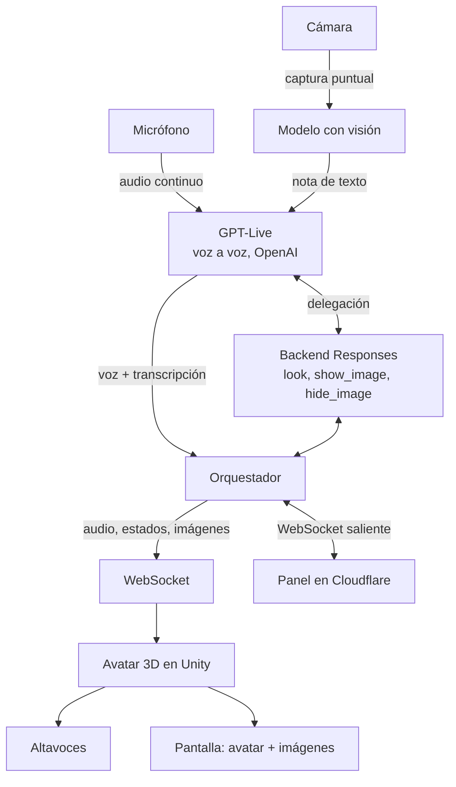

# Sonnia

**Asistente de IA por voz en tiempo real con avatar 3D.** Se escribe «Sonnia», con doble n como Sonnet Code, y se pronuncia «Sonia».

Sonia es una demo interactiva al estilo de los avatares de Grok: hablas con ella por el micrófono, te responde con voz natural y un avatar 3D femenino que se anima y sincroniza los labios mientras habla. Además puede verte a través de una cámara y mostrarte imágenes dentro de su propia escena 3D. La voz y la conversación las pone GPT-Live de OpenAI, un modelo voz a voz en tiempo real; la cámara la describe un modelo con visión; el avatar corre en Unity en el equipo del stand.

El proyecto se construye para el stand de [Sonnet Code](https://www.sonnetcode.com/es) en [DevFest Santo Domingo 2026](https://gdg.community.dev/events/details/google-gdg-santo-domingo-presents-devfest-santo-domingo-2026/), organizado por GDG Santo Domingo los días 9 y 10 de octubre de 2026 en la Biblioteca Nacional Pedro Henríquez Ureña.

## Objetivo de la demo

- Que cualquier visitante del stand pueda acercarse, hablar con Sonia y recibir una respuesta hablada al momento, y cortarla hablando si quiere, como en una conversación normal.
- Que Sonia sepa quién tiene delante: puede saludar a quien se acerca, comentar lo que ve y reaccionar a lo que le muestran a la cámara.
- Que pueda apoyar sus respuestas con imágenes que aparecen en su escena 3D, integradas con el avatar.
- Mostrar lo que se puede construir hoy integrando voz en tiempo real, visión, acciones y un avatar 3D.
- Servir como conversación de entrada sobre lo que hace Sonnet Code en IA aplicada.

## Arquitectura

Sonia se divide en dos procesos que se comunican por WebSocket en el equipo del stand, más dos servicios en la nube:

1. **Orquestador** (Python). Manda el micrófono a GPT-Live de forma continua, convierte su voz en frases para el avatar, ejecuta las acciones que pida, describe la cámara cuando alguien empieza a hablar y sirve el panel de control local.
2. **Avatar** (Unity). Renderiza a Sonia, reproduce el audio recibido, sincroniza los labios con los fonemas de la voz, dispara animaciones de escucha, pensamiento y habla, y muestra imágenes en la escena cuando el orquestador se lo indica.
3. **GPT-Live** (OpenAI). Oye, decide cuándo le hablan, contesta con su voz y delega las acciones en un backend de la API Responses.
4. **Panel de control** (Cloudflare). Web para el personal del stand; cada Sonia se conecta a él hacia fuera.



Todo va en streaming: el micrófono llega a GPT-Live a tiempo real, GPT-Live decide él solo cuándo contestar y su voz llega al avatar según se genera. Es full duplex: si el visitante habla mientras Sonia contesta, GPT-Live se calla y le escucha.

### Visión por cámara

Sonia no procesa vídeo continuo, y GPT-Live no acepta imágenes. La cámara entra de dos formas:

- **Al empezar a hablar alguien.** El orquestador toma una foto, un modelo con visión compatible con la API de OpenAI (configurado en `LLM_*`) la describe en una o dos frases, sin rasgos personales, y la descripción entra en la sesión de GPT-Live como nota silenciosa. Así Sonia sabe quién le habla sin que nadie lo pida.
- **Bajo demanda.** El backend de acciones dispone de `look`, que toma una captura fresca y se la pasa como imagen, por ejemplo si le piden que describa algo que le enseñan a la cámara.

Si el modelo configurado no acepta imágenes (`LLM_SUPPORTS_VISION=false`) o no hay cámara, la capa de visión se desactiva sin romper el resto.

### Imágenes en la escena 3D

La acción `show_image` muestra una imagen dentro del render de Unity, integrada con el avatar: Sonia señala hacia arriba y la imagen aparece en la franja alta de la pantalla. Las imágenes salen de una galería local incluida en el proyecto (`assets/gallery`: logos, diagramas, material del stand) o de la captura de cámara más reciente. `hide_image` la retira, y si nadie la retira se va sola a los 30 segundos.

### Animación de stand

Cuando lleva un rato sin nadie, Sonia no se queda callada: cada 40 a 90 segundos dice una frase corta (saludo, curiosidad de la biblioteca, promoción de Sonnet Code) acompañada a veces de un gesto de cuarta pared, o lanza un baile y "canta" encima. Las frases y los cantos están en `assets/showcase/frases.md` y `assets/showcase/cantos.md`, una por línea, editables sin tocar código. Se graban una vez con la voz de GPT-Live (`cache/voice`) y luego se reproducen sin gastar. Se configura con las variables `SHOWCASE_*` y se corta en cuanto alguien habla.

### Panel de control

El personal del stand controla a Sonia desde el móvil en `https://sonia.sonnetcode.com` (con un panel local de respaldo en `http://127.0.0.1:8780`): modos Conversando, Solo saludos (frases grabadas, sin gasto ni red) y Fuera (sale caminando y deja un letrero), avisos del día, imágenes, volumen, sensibilidad del micrófono y el estado de cada pieza en lenguaje llano. Detalle en `docs/panel.md`.

## Stack

| Capa | Tecnología | Notas |
|---|---|---|
| Voz y conversación | GPT-Live (`gpt-live-1`) de OpenAI | Voz a voz por WebSocket, full duplex, con transcripción en los dos sentidos. 0,05 USD por minuto de sesión. |
| Acciones | Backend de la API Responses (`gpt-6-luna`) | GPT-Live delega `look`, `show_image` y `hide_image`. |
| Visión | Cámara USB con OpenCV + modelo con visión | Capturas puntuales descritas en texto, nunca vídeo continuo. |
| Avatar | Unity 6 con assets gratuitos | Personaje femenino, lip-sync por fonemas (uLipSync), animaciones de estado, panel de imágenes en escena. Pantalla vertical 9:16. |
| Panel de control | Cloudflare Workers + Durable Objects | Ve todas las Sonias conectadas (pueden ser varias, en sitios distintos) y deja elegir cuál se controla. |
| Orquestación | Python 3.12 | Servidor WebSocket hacia Unity, micrófono, cámara y panel local. |

Los modelos y la voz se eligen por variables de entorno (`LIVE_MODEL`, `LIVE_VOICE`, `LIVE_BACKEND_MODEL`, `LLM_*`): ver `.env.example`.

## Requisitos

Un equipo con micrófono, altavoces, pantalla en vertical, una cámara USB apuntando a la zona donde se colocan los visitantes e **internet estable**: sin red, Sonia no conversa (el modo "Solo saludos" sigue funcionando). No hace falta GPU dedicada: los modelos corren en la nube y el equipo solo mueve Unity y el orquestador. El equipo del stand está por decidir; todo funciona en macOS y Windows.

## Estructura del repositorio

```
sonia/
├── server/           # Orquestador en Python
│   ├── sonia/        # Paquete: live, actions, vision, llm, audio, ws, panel...
│   └── tests/        # Pruebas (sin hardware, sin red, sin APIs reales)
├── unity/            # Proyecto Unity con el avatar, lip-sync, animaciones y panel de imágenes
├── cloud/panel/      # Panel de control en Cloudflare (Worker + Durable Object)
├── scripts/          # Modo kiosco, checks del stand, sonda del WebSocket, herramientas del avatar
├── docs/             # Arquitectura, protocolo, panel, decisiones de diseño, guía del stand
├── assets/gallery/   # Galería local de imágenes que Sonia puede mostrar
├── assets/knowledge/ # Base de conocimiento de Sonia (evento, GDG, biblioteca, Sonnet Code)
├── assets/showcase/  # Frases, cantos y saludos fijos
├── CLAUDE.md         # Contexto y convenciones para trabajar con Claude Code
└── README.md
```

## Puesta en marcha

1. `cd server && uv sync --extra audio --extra camera --extra panel` (añade `--group dev` para tests y lint).
2. `cp .env.example .env` desde la raíz y poner `OPENAI_API_KEY` (la usan GPT-Live y el modelo de visión) y, si el equipo sale en el panel de Cloudflare, `PANEL_CLOUD_TOKEN`.
3. `uv run sonia check`: micrófono, cámara, una sesión de GPT-Live (abrir y cerrar), modelo de visión y galería.
4. `uv run sonia say "Hola, soy Sonia"` para oír la voz (`LIVE_VOICE`) y `uv run sonia chat` para escribirle por consola.
5. `uv run sonia run`: demo completa (orquestador, servidor WebSocket y panel local).
6. Abre el proyecto de Unity y dale a Play, o ejecuta la build empaquetada. Ver `docs/unity.md` para el detalle de esa parte.

Para el día del evento, ver la guía operativa completa en `docs/stand.md` (instalación en el equipo del stand, montaje, checklist de arranque, qué hacer si algo falla, y `scripts/kiosk.sh` para dejar el stand desatendido con reinicio automático).

## Probar sin micrófono

```bash
cd server
uv run --no-sync sonia run --no-mic                              # GPT-Live sin micrófono: solo text_input
uv run --no-sync python ../scripts/ws_probe.py "Hola Sonia"      # envía texto y registra los mensajes
```

Con Unity en Play y conectado a `ws://127.0.0.1:8765`, el texto del `ws_probe` (o de la caja de texto de los controles de desarrollo de Unity) hace hablar a Sonia con la voz de GPT-Live, y los renders 9:16 se guardan con el menú `Sonia > Captura vertical 9:16`. Esto abre una sesión de GPT-Live y gasta: para ver la boca con voz real sin gastar, pon a Sonia en "Solo saludos" desde el panel local y pulsa "Saludar ahora" (reproduce una frase ya grabada en `cache/voice`).

Los tests (`uv run --no-sync pytest -q`) nunca llaman a APIs reales.

## Hoja de ruta

Lo que queda pendiente, con detalle y por orden de urgencia, está en [`ROADMAP.md`](ROADMAP.md).

- [x] Motor voz a voz con GPT-Live de OpenAI: full duplex, acciones por delegación en un backend Responses y ojos por notas de la cámara (ADR 007)
- [x] Probado con la API real: audio continuo a ritmo real, textos escritos y frases fijas por `session.commentary.append`, limpieza de marcas como "[laugh]" y renovación de la sesión antes de los 120 minutos
- [x] Servidor WebSocket con protocolo de eventos hacia Unity
- [x] Descripción de la cámara al empezar cada turno y acción `look` bajo demanda
- [x] Acciones `show_image` y `hide_image` con galería local
- [x] Persona de Sonia como asistente y staff del DevFest, con base de conocimiento editable en `assets/knowledge/`
- [x] Panel de control web para el personal del stand (`docs/panel.md`): modos Conversando, Solo saludos y Fuera, avisos, imágenes, volumen, salud en lenguaje llano
- [x] Panel alojado en Cloudflare (`sonia.sonnetcode.com`, `cloud/panel/`) que ve todas las Sonias conectadas y avisa de duplicados
- [ ] Cloudflare Access delante del panel (de momento, contraseña)
- [x] Scripts de Unity: cliente WebSocket, audio en streaming, lip-sync, estados, panel de imágenes, webcam, subtítulos, escena base 9:16
- [x] Pantalla en su estado final: solo Sonia, logo y subtítulos (controles de desarrollo con `-dev-ui`)
- [x] Modo kiosco para el stand (`scripts/kiosk.sh`) y guía de montaje (`docs/stand.md`)
- [x] Avatar femenino (Babe, Ready Player Me) con lip-sync por fonemas en tiempo real (uLipSync), mirada de ojos con sacadas, parpadeo, animación por código (Playables) con clips de Ready Player Me y Mixamo encadenados sin cortes, idle con bailes y gestos de cuarta pared, iluminación de estudio, encuadre 9:16 y marca de Sonnet Code
- [ ] Prueba completa con micrófono, cámara y Unity en el equipo del stand
- [x] Imágenes de marca en `assets/gallery/` (logo y fondo de Sonnet Code); faltan servicios y diagrama de Sonia

El motor anterior (detector de voz, reconocedor, modelo de texto y TTS en cascada, pensado para correr en local) se retiró el 4 de octubre de 2026; su historia está en `docs/decisiones/` y en `git log`.

## Créditos

Desarrollado por el equipo de [Sonnet Code](https://www.sonnetcode.com/es) para DevFest Santo Domingo 2026. Los assets del avatar provienen de paquetes gratuitos; `docs/licencias.md` es un registro opcional de sus licencias.
