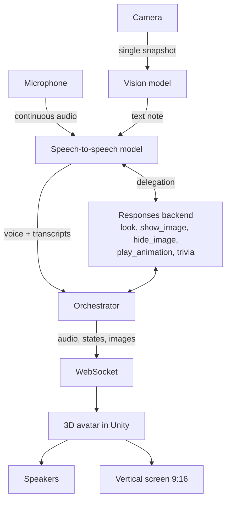

# Sonnia SDK

**A real-time voice AI assistant with a 3D avatar.** You talk to Sonnia through a microphone, she answers out loud with a natural voice while a 3D character lip-syncs and gestures on a vertical screen. She can glance at a camera when it helps, show images inside her scene and run small interactive activities such as a trivia game.

Sonnia was born as a booth demo at a developer conference and is now released as an open-source starting point for anyone who wants to build a talking, animated AI character for kiosks, events, museums or streams.

> **Status: early public release.** The orchestrator passes its offline test suite and the Unity client was verified against a simulated orchestrator, with and without the Genies SDK. A full run against the real voice model has not been done yet since the public release. See [Roadmap](#roadmap) and [Known limitations](#known-limitations).

## How it works

Sonnia runs as two local processes that talk over a WebSocket, plus cloud models:

1. **Orchestrator** (Python 3.12). Streams the microphone to the speech-to-speech model, splits the model's voice into utterances for the avatar, runs the actions the model asks for, takes camera snapshots on demand and serves a local control panel.
2. **Avatar client** (Unity 6, URP). Renders the character, plays the incoming audio, drives phoneme-based lip-sync, eyes and body animation, and shows images, subtitles and game screens.
3. **Speech-to-speech model** (OpenAI GPT-Live over a raw WebSocket). Listens continuously, handles turn-taking and barge-in on its own (full duplex) and speaks with its own voice. Tool calls are delegated to a Responses API backend model.
4. **Vision model** (any OpenAI-compatible endpoint with image input). Describes single camera snapshots in text. Sonnia never streams video to a model.



Everything is streamed: the microphone reaches the model in real time and the voice reaches the avatar as it is generated. The latency goal is under two seconds from the end of the user's turn to the first word of the answer.

### Design principles

- **Speech to speech, one engine.** No cascaded VAD, ASR, LLM and TTS pipeline: the realtime model owns listening, turn-taking and interruptions.
- **Latency first.** Streaming everywhere; camera descriptions run in parallel and never block an answer.
- **Built for long unattended sessions.** Reconnection with backoff, sessions renewed before they expire, timeouts and graceful degradation. Nothing that happens in a model session, the camera, the microphone or Unity should take the process down.
- **Cost under control.** No session is opened while nobody can talk to the avatar. Tests never call real APIs.
- **Privacy by default.** Camera frames are never written to disk (except in an explicit debug mode) and are only sent to a model as single, downscaled snapshots.
- **Vertical screen.** The scene, subtitles and image panel are designed for a 1080x1920 portrait display.

### The avatar

The Unity client uses its own animation stack (Playables API, no Animator Controller), phoneme lip-sync with [uLipSync](https://github.com/hecomi/uLipSync), procedural eye gaze, blinking and breathing.

The character itself is pluggable:

- **Genies Avatar SDK (optional).** If you import the free [Genies Avatar SDK](https://genies.com) from the Unity Asset Store and add your own credentials, Sonnia loads a fully customizable Genies avatar at runtime. The SDK is proprietary and is **not** included in this repository.
- **Fallback avatar.** Without the SDK, the client uses a character from the Genies Avatar Starter Pack, which is distributed under a permissive license.

## Getting started

1. Copy `.env.example` to `.env` at the repository root and set `OPENAI_API_KEY`.
2. Start the orchestrator from `server/` (details in [`server/README.md`](server/README.md)):

   ```bash
   cd server
   uv sync --extra audio --extra camera --extra panel
   uv run sonia run
   ```

3. Open `unity/` with Unity 6000.6.0f1, set the Game view to 1080x1920 and press Play (details in [`unity/README.md`](unity/README.md)).
4. Talk to Sonnia. The local control panel is at `http://127.0.0.1:8780`.

Customize her by editing plain files, no code needed: what she knows in `assets/knowledge/`, the lines she says while idle in `assets/showcase/`, the trivia questions in `assets/trivia/questions.md` and the images she can show in `assets/gallery/`.

The written name is "Sonnia". Texts read by the voice model spell it "Sonia" so it is pronounced right; the code identifiers (`sonia` package, `Sonia` namespace) keep that spelling too.

## Roadmap

- [x] License, architecture overview and the [WebSocket protocol](docs/protocol.md) between the orchestrator and the avatar client
- [x] Python orchestrator: realtime voice engine, actions (`look`, `show_image`, `hide_image`, `play_animation`), camera snapshots, local control panel, idle lines, trivia mode
- [x] Unity client: avatar, lip-sync, animation, vertical stage, image panel, subtitles, trivia screen, optional Genies integration
- [x] `.env.example` and a sample knowledge base
- [ ] Step-by-step setup guide for macOS and Windows, including player builds
- [ ] Continuous integration (lint, type checks and tests without network access)
- [ ] A walk cycle for the default avatar (without the Genies SDK it slides off screen in away mode)

## Known limitations

- Player builds have not been tested since the public release; running from the Unity editor works.
- Without the Genies SDK there is no walk cycle: in away mode the avatar slides off screen.
- On Windows, the Genies SDK needs the Visual C++ runtime.

## History

Sonnia was developed in a private repository between September and October 2026 and ran live for two days at a developer conference. Its commit history is kept here, filtered: third-party assets that cannot be redistributed, brand logos and personal data were removed from every commit, and the commit messages were translated to English. The commits before "Start the public release" therefore show the original, event-specific project in Spanish; everything after it is the generic, English-only Sonnia SDK.

## Requirements

- A computer with a microphone, speakers, a screen (ideally in portrait orientation) and, optionally, a USB camera.
- A stable internet connection: the voice model runs in the cloud. No dedicated GPU is needed.
- An OpenAI API key with access to the realtime speech-to-speech model and the Responses API.
- Python 3.12 with [uv](https://docs.astral.sh/uv/) and Unity 6 (6000.6) for the avatar client.

macOS and Windows are both supported targets.

## Cost

Realtime speech-to-speech sessions are billed per minute while they are open, plus the tokens of the backend and vision models. Sonnia only opens a session when it can actually hold a conversation, and the test suite never calls a real API.

## License

Sonnia SDK is released under the [MIT License](LICENSE).

Third-party packages and assets keep their own licenses. In particular, the Genies Avatar SDK is proprietary and must be obtained from its vendor; the models used through their APIs are not distributed with this project.
