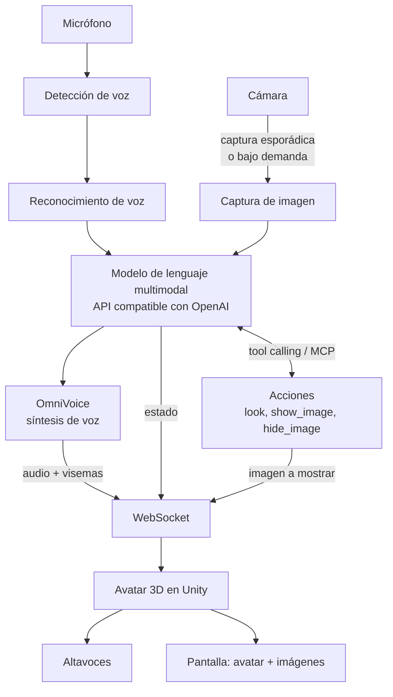

# Sonia

**Asistente de IA por voz en tiempo real con avatar 3D, 100 % local.**

Sonia es una demo interactiva al estilo de los avatares de Grok: hablas con ella por el micrófono, te responde con voz natural y un avatar 3D femenino que se anima y sincroniza los labios mientras habla. Además puede verte a través de una cámara y mostrarte imágenes dentro de su propia escena 3D. Todo el pipeline (reconocimiento de voz, visión, modelo de lenguaje, síntesis de voz y render del avatar) corre en una sola máquina, sin enviar nada a la nube.

El proyecto se construye para el stand de [Sonnet Code](https://www.sonnetcode.com/es) en [DevFest Santo Domingo 2026](https://gdg.community.dev/events/details/google-gdg-santo-domingo-presents-devfest-santo-domingo-2026/), organizado por GDG Santo Domingo los días 9 y 10 de octubre de 2026 en la Biblioteca Nacional Pedro Henríquez Ureña.

## Objetivo de la demo

- Que cualquier visitante del stand pueda acercarse, hablar con Sonia y recibir una respuesta hablada en pocos segundos.
- Que Sonia sepa quién tiene delante: puede saludar a quien se acerca, comentar lo que ve y reaccionar a lo que le muestran a la cámara.
- Que pueda apoyar sus respuestas con imágenes que aparecen en su escena 3D, integradas con el avatar.
- Mostrar que una experiencia de este tipo es viable con modelos abiertos corriendo en hardware propio.
- Servir como conversación de entrada sobre lo que hace Sonnet Code en IA aplicada.

## Arquitectura

Sonia se divide en dos procesos que se comunican por WebSocket en la misma máquina:

1. **Orquestador** (Python). Captura el micrófono y la cámara, detecta cuándo el usuario habla, transcribe, consulta el modelo de lenguaje (con imágenes de la cámara cuando toca), ejecuta las acciones que el modelo pida, sintetiza la respuesta con OmniVoice y envía audio, eventos e imágenes al avatar.
2. **Avatar** (Unity). Renderiza a Sonia, reproduce el audio recibido, sincroniza los labios con la voz, dispara animaciones de escucha, pensamiento y habla, y muestra imágenes en la escena cuando el orquestador se lo indica.



La respuesta se procesa en streaming de extremo a extremo: el texto del modelo se trocea en frases, cada frase se sintetiza en cuanto está lista y el avatar empieza a hablar antes de que el modelo termine de generar.

### Visión por cámara

Sonia no procesa vídeo continuo. La cámara entra en el pipeline de dos formas:

- **Capturas esporádicas.** El orquestador toma una foto cuando detecta que alguien empieza a hablar, y opcionalmente cada cierto tiempo mientras hay alguien delante, y la adjunta al siguiente turno del modelo. Así Sonia sabe quién le habla sin que el modelo tenga que pedirlo.
- **Bajo demanda del modelo.** El modelo dispone de una acción `look` (expuesta como tool calling o como servidor MCP) que devuelve una captura fresca. La usa cuando la conversación lo requiere, por ejemplo si le piden que describa algo que le enseñan a la cámara.

Ambas rutas alimentan el mismo endpoint multimodal, así que el modelo de visión es intercambiable igual que el de texto. Si el modelo configurado no acepta imágenes, la capa de visión se desactiva sin romper el resto.

### Imágenes en la escena 3D

El modelo dispone de una acción `show_image` para mostrar una imagen dentro del render de Unity, integrada con el avatar: un panel o pantalla en la escena hacia el que Sonia puede girarse o señalar mientras habla. Las imágenes salen de una galería local incluida en el proyecto (logos, diagramas, fotos del equipo, material del stand) o de la captura de cámara más reciente, por ejemplo para enseñarle al visitante lo que Sonia acaba de ver. Un `hide_image` retira el panel.

### Animación de stand

Cuando lleva un rato sin nadie, Sonia no se queda callada: cada 40 a 90 segundos dice una frase corta (saludo, curiosidad de la biblioteca, promoción de Sonnet Code) acompañada a veces de un gesto de cuarta pared, o lanza un baile y "canta" encima. Las frases y los cantos están en `assets/showcase/frases.md` y `assets/showcase/cantos.md`, una por línea, editables sin tocar código. No consumen tokens del modelo. Se configura con las variables `SHOWCASE_*` (activar, primer retardo, intervalo, probabilidad de baile) y se corta en cuanto alguien habla.

## Stack

| Capa | Tecnología | Notas |
|---|---|---|
| Modelo de lenguaje | Kimi K3 (por defecto) | Multimodal, servido localmente detrás de una API compatible con OpenAI. Cualquier otro modelo funciona cambiando la configuración. |
| Servidor de inferencia | llama.cpp, vLLM u Ollama | Cualquiera que exponga `/v1/chat/completions`. |
| Síntesis de voz | OmniVoice | Corre local, voz femenina en español. Respaldo de bajo consumo: la voz del sistema (`TTS_BACKEND=system`). |
| Reconocimiento de voz | faster-whisper | Modelo local, español. |
| Detección de voz | Silero VAD | Determina inicio y fin de cada turno del usuario. |
| Visión | Cámara USB con OpenCV | Capturas puntuales enviadas al modelo multimodal, nunca vídeo continuo. |
| Acciones del modelo | Tool calling con fallback a MCP | Acciones `look`, `show_image` y `hide_image`. |
| Avatar | Unity con assets gratuitos | Personaje femenino, lip-sync por visemas, animaciones de estado, panel de imágenes en escena. |
| Orquestación | Python 3.12 | Servidor WebSocket y pipeline de audio. |

### Agnóstico al modelo

El orquestador no conoce Kimi K3 ni ningún modelo en particular. Habla con un endpoint compatible con OpenAI y solo necesita tres variables:

```env
LLM_BASE_URL=http://localhost:8000/v1
LLM_MODEL=kimi-k3
LLM_API_KEY=local
```

Cambiar de modelo es cambiar esas variables y reiniciar. Lo mismo aplica al proveedor de voz: OmniVoice se integra detrás de una interfaz `TextToSpeech` que se puede sustituir por otro motor.

Las acciones del modelo siguen el formato estándar de tool calling de la API de OpenAI, que la mayoría de servidores locales soportan. Para modelos o servidores sin tool calling nativo, las mismas acciones se exponen como servidor MCP local.

## Requisitos de hardware

La demo está pensada para una sola máquina con GPU dedicada, micrófono, altavoces, pantalla y una cámara USB apuntando a la zona donde se colocan los visitantes. El modelo de lenguaje es el componente que más memoria consume, así que el modelo concreto que se use en el stand dependerá de la VRAM disponible. El pipeline completo debe caber en memoria junto con Unity para mantener la latencia por debajo de dos segundos entre que el usuario termina de hablar y Sonia empieza a responder. Adjuntar una imagen al turno añade tiempo de prefill, por eso las capturas se envían reducidas y solo cuando aportan.

## Estructura del repositorio

```
sonia/
├── server/           # Orquestador en Python
│   ├── sonia/        # Paquete: audio, stt, llm, tts, vision, actions, ws, mcp...
│   └── tests/        # Pruebas (sin modelos ni hardware, sin red)
├── unity/            # Proyecto Unity con el avatar, lip-sync, animaciones y panel de imágenes
├── scripts/          # Descarga de modelos, arranque de servidores, modo kiosco, checks del stand
├── docs/             # Arquitectura, protocolo, decisiones de diseño, licencias, guía del stand
├── assets/gallery/   # Galería local de imágenes que Sonia puede mostrar
├── assets/showcase/  # Frases y cantos de la animación de stand (idle)
├── CLAUDE.md         # Contexto y convenciones para trabajar con Claude Code
└── README.md
```

## Puesta en marcha

1. `cd server && uv sync --extra all` — instala las dependencias del orquestador (todos los extras: audio, stt, omnivoice, camera, mcp).
2. `cp .env.example .env` y edita el archivo con la configuración de tu máquina (modelo de LLM, dispositivo de audio, etc.).
3. `scripts/download_models.sh` — descarga los modelos locales (faster-whisper, Silero VAD y, si instalaste el extra `omnivoice`, los pesos de OmniVoice).
4. `scripts/run_llm_server.sh` (con el `BACKEND` que corresponda) para levantar un servidor de LLM local, o deja apuntado en `.env` el endpoint provisional en la nube mientras no haya uno.
5. `uv run sonia check` — comprueba audio, VAD, STT, cámara, endpoint del LLM (y que acepte imágenes y `tools`), TTS y galería.
6. `uv run sonia chat` — prueba el pipeline de texto a voz sin necesidad de micrófono ni cámara.
7. `uv run sonia run` — arranca la demo completa (orquestador + servidor WebSocket).
8. Abre el proyecto de Unity y dale a Play, o ejecuta la build empaquetada. Ver `docs/unity.md` para el detalle de esa parte.

Para el día del evento en sí, ver la guía operativa completa en `docs/stand.md` (montaje, checklist de arranque, qué hacer si algo falla, y `scripts/kiosk.sh` para dejar el stand desatendido con reinicio automático).

## Ensayar sin nube ni hardware

Para probar el avatar, el lip-sync y los estados sin gastar tokens ni tener micrófono:

```bash
cd server
uv run --no-sync python ../scripts/fake_llm_server.py --port 8001      # modelo falso con frases fijas
LLM_BASE_URL=http://127.0.0.1:8001/v1 LLM_API_KEY=x LLM_MODEL=fake \
TTS_BACKEND=gemini STT_BACKEND=mock VISION_SOURCE=none \
uv run --no-sync sonia run --no-mic                                     # orquestador solo con text_input
uv run --no-sync python ../scripts/ws_probe.py "Hola Sonia"             # envía texto y registra los mensajes
```

Con Unity en Play y conectado a `ws://127.0.0.1:8765`, el texto del `ws_probe` (o del HUD de Unity) hace hablar a Sonia con la voz de Gemini Live (free tier; con `TTS_BACKEND=system` se usa la voz del sistema operativo, sin red pero más robótica), y los renders 9:16 se guardan con el menú `Sonia > Captura vertical 9:16`.

## Hoja de ruta

- [x] Orquestador: máquina de estados que conecta VAD, STT, LLM y TTS en streaming (`sonia/orchestrator.py`, `sonia run`, `sonia chat`, `sonia check`)
- [x] Servidor WebSocket con protocolo de eventos hacia Unity
- [x] Interrupción: Sonia se calla cuando el usuario empieza a hablar (barge-in por VAD e `interrupt` desde Unity)
- [x] Captura de cámara al inicio de cada turno y acción `look` bajo demanda
- [x] Acciones `show_image` y `hide_image` con galería local
- [x] Servidor MCP local con las mismas acciones
- [x] Persona de Sonia como asistente y staff del DevFest, con base de conocimiento editable en `assets/knowledge/`
- [x] Descripción dinámica del stack en el prompt (Sonia sabe qué modelo, voz y oídos usa en cada momento)
- [x] Voz provisional con la API Live de Gemini mientras no hay GPU (ADR 006)
- [x] Scripts de Unity: cliente WebSocket, audio en streaming, lip-sync, estados, panel de imágenes, webcam, HUD, escena base 9:16
- [x] Modo kiosco para el stand (`scripts/kiosk.sh`) y guía de montaje (`docs/stand.md`)
- [ ] Integración de OmniVoice con el modelo real (módulo listo; falta la GPU)
- [ ] Servidor local del modelo de lenguaje en el mini PC del stand (`scripts/run_llm_server.sh`)
- [x] Avatar femenino (Babe, Ready Player Me) con lip-sync por fonemas en tiempo real (uLipSync) o visemas del orquestador, mirada de ojos con sacadas, parpadeo, animación por código (Playables) con 60 clips de Ready Player Me y Mixamo encadenados sin cortes, idle con bailes y gestos de cuarta pared, iluminación de estudio, encuadre 9:16 y marca de Sonnet Code
- [x] Batería de escenarios en Unity con el orquestador en modo ensayo (habla, interrupción, imágenes, reconexión, reinicio por inactividad)
- [ ] Prueba completa con micrófono, cámara y Unity en el equipo del stand
- [x] Imágenes de marca en `assets/gallery/` (logo y fondo de Sonnet Code); faltan servicios y diagrama de Sonia

## Estado provisional

Mientras no llega el mini PC del stand, el modelo de lenguaje se consume desde la API de Kimi en la nube y la voz desde la API Live de Gemini, a través de las mismas interfaces que usarán los modelos locales. Sonia sabe cuándo está en ese modo y lo dice si le preguntan. Los tests nunca llaman a APIs reales.

## Créditos

Desarrollado por el equipo de [Sonnet Code](https://www.sonnetcode.com/es) para DevFest Santo Domingo 2026. Los assets del avatar provienen de paquetes gratuitos cuyas licencias se listan en `docs/licencias.md`.
