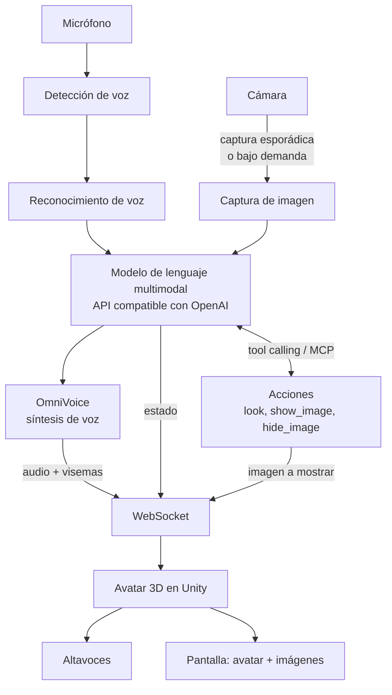

# Sonia

**Asistente de IA por voz en tiempo real con avatar 3D, 100 % local.**

Sonia es una demo interactiva al estilo de los avatares de Grok: hablas con ella por el micrófono, te responde con voz natural y un avatar 3D femenino que se anima y sincroniza los labios mientras habla. Además puede verte a través de una cámara y mostrarte imágenes dentro de su propia escena 3D. Todo el pipeline (reconocimiento de voz, visión, modelo de lenguaje, síntesis de voz y render del avatar) corre en una sola máquina, sin enviar nada a la nube.

El proyecto se construye para el stand de [Sonnet Code](https://www.sonnetcode.com/es) en [DevFest Santo Domingo 2026](https://gdg.community.dev/events/details/google-gdg-santo-domingo-presents-devfest-santo-domingo-2026/), organizado por GDG Santo Domingo los días 9 y 10 de octubre de 2026 en la Biblioteca Nacional Pedro Henríquez Ureña.

## Objetivo de la demo

- Que cualquier visitante del stand pueda acercarse, hablar con Sonia y recibir una respuesta hablada en pocos segundos.
- Que Sonia sepa quién tiene delante: puede saludar a quien se acerca, comentar lo que ve y reaccionar a lo que le muestran a la cámara.
- Que pueda apoyar sus respuestas con imágenes que aparecen en su escena 3D, integradas con el avatar.
- Mostrar que una experiencia de este tipo es viable con modelos abiertos corriendo en hardware propio.
- Servir como conversación de entrada sobre lo que hace Sonnet Code en IA aplicada.

## Arquitectura

Sonia se divide en dos procesos que se comunican por WebSocket en la misma máquina:

1. **Orquestador** (Python). Captura el micrófono y la cámara, detecta cuándo el usuario habla, transcribe, consulta el modelo de lenguaje (con imágenes de la cámara cuando toca), ejecuta las acciones que el modelo pida, sintetiza la respuesta con OmniVoice y envía audio, eventos e imágenes al avatar.
2. **Avatar** (Unity). Renderiza a Sonia, reproduce el audio recibido, sincroniza los labios con la voz, dispara animaciones de escucha, pensamiento y habla, y muestra imágenes en la escena cuando el orquestador se lo indica.



La respuesta se procesa en streaming de extremo a extremo: el texto del modelo se trocea en frases, cada frase se sintetiza en cuanto está lista y el avatar empieza a hablar antes de que el modelo termine de generar.

### Visión por cámara

Sonia no procesa vídeo continuo. La cámara entra en el pipeline de dos formas:

- **Capturas esporádicas.** El orquestador toma una foto cuando detecta que alguien empieza a hablar, y opcionalmente cada cierto tiempo mientras hay alguien delante, y la adjunta al siguiente turno del modelo. Así Sonia sabe quién le habla sin que el modelo tenga que pedirlo.
- **Bajo demanda del modelo.** El modelo dispone de una acción `look` (expuesta como tool calling o como servidor MCP) que devuelve una captura fresca. La usa cuando la conversación lo requiere, por ejemplo si le piden que describa algo que le enseñan a la cámara.

Ambas rutas alimentan el mismo endpoint multimodal, así que el modelo de visión es intercambiable igual que el de texto. Si el modelo configurado no acepta imágenes, la capa de visión se desactiva sin romper el resto.

### Imágenes en la escena 3D

El modelo dispone de una acción `show_image` para mostrar una imagen dentro del render de Unity, integrada con el avatar: un panel o pantalla en la escena hacia el que Sonia puede girarse o señalar mientras habla. Las imágenes salen de una galería local incluida en el proyecto (logos, diagramas, fotos del equipo, material del stand) o de la captura de cámara más reciente, por ejemplo para enseñarle al visitante lo que Sonia acaba de ver. Un `hide_image` retira el panel.

## Stack

| Capa | Tecnología | Notas |
|---|---|---|
| Modelo de lenguaje | Kimi K3 (por defecto) | Multimodal, servido localmente detrás de una API compatible con OpenAI. Cualquier otro modelo funciona cambiando la configuración. |
| Servidor de inferencia | llama.cpp, vLLM u Ollama | Cualquiera que exponga `/v1/chat/completions`. |
| Síntesis de voz | OmniVoice | Corre local, voz femenina en español. |
| Reconocimiento de voz | faster-whisper | Modelo local, español. |
| Detección de voz | Silero VAD | Determina inicio y fin de cada turno del usuario. |
| Visión | Cámara USB con OpenCV | Capturas puntuales enviadas al modelo multimodal, nunca vídeo continuo. |
| Acciones del modelo | Tool calling con fallback a MCP | Acciones `look`, `show_image` y `hide_image`. |
| Avatar | Unity con assets gratuitos | Personaje femenino, lip-sync por visemas, animaciones de estado, panel de imágenes en escena. |
| Orquestación | Python 3.12 | Servidor WebSocket y pipeline de audio. |

### Agnóstico al modelo

El orquestador no conoce Kimi K3 ni ningún modelo en particular. Habla con un endpoint compatible con OpenAI y solo necesita tres variables:

```env
LLM_BASE_URL=http://localhost:8000/v1
LLM_MODEL=kimi-k3
LLM_API_KEY=local
```

Cambiar de modelo es cambiar esas variables y reiniciar. Lo mismo aplica al proveedor de voz: OmniVoice se integra detrás de una interfaz `TextToSpeech` que se puede sustituir por otro motor.

Las acciones del modelo siguen el formato estándar de tool calling de la API de OpenAI, que la mayoría de servidores locales soportan. Para modelos o servidores sin tool calling nativo, las mismas acciones se exponen como servidor MCP local.

## Requisitos de hardware

La demo está pensada para una sola máquina con GPU dedicada, micrófono, altavoces, pantalla y una cámara USB apuntando a la zona donde se colocan los visitantes. El modelo de lenguaje es el componente que más memoria consume, así que el modelo concreto que se use en el stand dependerá de la VRAM disponible. El pipeline completo debe caber en memoria junto con Unity para mantener la latencia por debajo de dos segundos entre que el usuario termina de hablar y Sonia empieza a responder. Adjuntar una imagen al turno añade tiempo de prefill, por eso las capturas se envían reducidas y solo cuando aportan.

## Estructura del repositorio

```
sonia/
├── server/     # Orquestador en Python: VAD, STT, LLM, TTS y WebSocket
├── unity/      # Proyecto Unity con el avatar, lip-sync, animaciones y panel de imágenes
├── assets/     # Galería local de imágenes que Sonia puede mostrar
├── scripts/    # Utilidades para levantar los servicios locales
├── docs/       # Decisiones de diseño y guías de montaje del stand
├── CLAUDE.md   # Contexto y convenciones para trabajar con Claude Code
└── README.md
```

## Puesta en marcha

El proyecto está en fase inicial. Estos son los pasos previstos una vez exista el código:

1. Levantar el servidor de inferencia con el modelo elegido y anotar su URL.
2. Copiar `.env.example` a `.env` y ajustar las variables del modelo.
3. Instalar las dependencias del orquestador e iniciarlo.
4. Conectar la cámara y comprobar que el orquestador la detecta.
5. Abrir el proyecto de Unity y darle a Play, o ejecutar la build empaquetada.
6. Hablar.

## Hoja de ruta

- [ ] Orquestador con VAD, STT, LLM y TTS en streaming
- [ ] Servidor WebSocket con protocolo de eventos hacia Unity
- [ ] Integración de OmniVoice con voz femenina en español
- [ ] Avatar en Unity con lip-sync por visemas
- [ ] Animaciones de escucha, pensamiento y habla
- [ ] Captura de cámara al inicio de cada turno y acción `look` bajo demanda
- [ ] Acciones `show_image` y `hide_image` con panel de imágenes integrado en la escena
- [ ] Servidor MCP local como alternativa al tool calling nativo
- [ ] Interrupción: que Sonia se calle cuando el usuario empieza a hablar
- [ ] Modo kiosco para el stand: reinicio automático y sin teclado
- [ ] Guía de montaje y checklist para el día del evento

## Créditos

Desarrollado por el equipo de [Sonnet Code](https://www.sonnetcode.com/es) para DevFest Santo Domingo 2026. Los assets del avatar provienen de paquetes gratuitos cuyas licencias se listan en `docs/licencias.md`.
