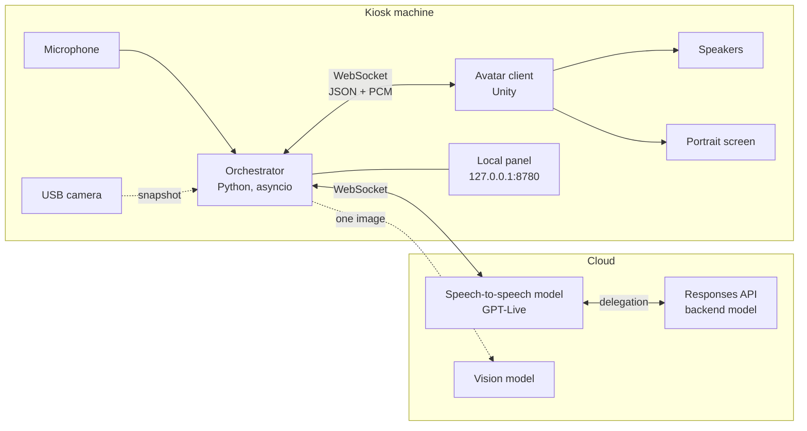
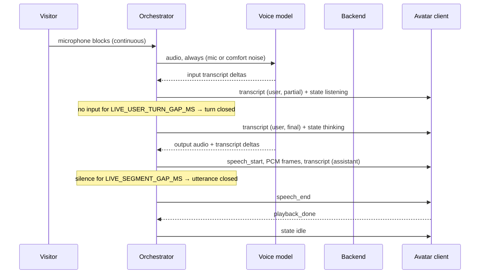
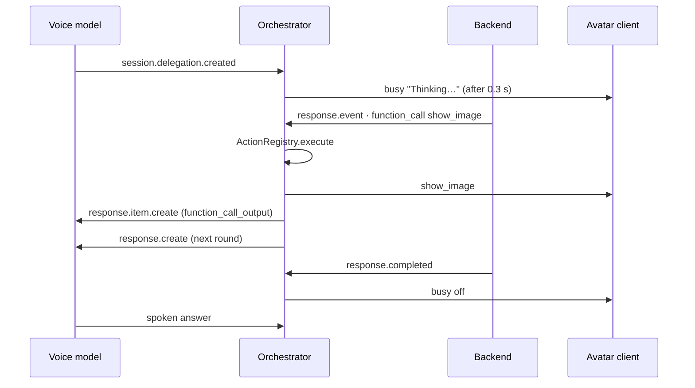

# Architecture

This guide explains how Sonnia works inside: which processes run, which asyncio tasks live in the orchestrator, how a spoken answer travels from the voice model to the avatar's lips, and what happens when something fails. For the message-level contract between the orchestrator and the avatar client, see [`protocol.md`](protocol.md). For every setting mentioned here, see [`configuration.md`](configuration.md).

## The pieces

- **Orchestrator** (`server/sonia`). A single Python process built on asyncio. It owns every connection to the cloud, the microphone, the camera, the actions and the local control panel. It never renders anything.
- **Avatar client** (`unity/`). A Unity app that renders the character, plays the voice it receives, derives lip-sync from that audio and draws subtitles, images and game screens. It knows nothing about models: it only speaks the [WebSocket protocol](protocol.md).
- **Speech-to-speech model.** One realtime session over a raw WebSocket (`sonia/live/client.py`, no SDK). It hears the microphone continuously, decides on its own when it is spoken to, handles interruptions and speaks with its own voice.
- **Responses backend.** When the voice model needs to *do* something (look through the camera, show an image, start a trivia game, search the web), it delegates the task to a backend model through the API. The backend sees Sonnia's tools; the orchestrator runs them and returns the results.
- **Vision model.** Any OpenAI-compatible model with image input. It turns single camera snapshots into text, because the speech-to-speech model takes no images.

## Inside the orchestrator

`sonia run` (`cmd_run` in `sonia/cli.py`) builds the components and starts these long-lived asyncio tasks:

| Task | Code | What it does |
|---|---|---|
| `live-engine` | `LiveEngine.run` | Keeps a voice session open, reconnecting with growing waits. Inside it, one session at a time reads model events. |
| `sonia-live-tick` | `LiveEngine._tick_loop` | Every 50 ms: closes finished utterances, closes the user's turn, infers the avatar state, updates the waiting indicator, ticks the trivia game, renews the session and runs the idle animation. |
| `sonia-gallery` | `LiveEngine._gallery_loop` | Watches `assets/gallery` and tells the open session about added or removed images. |
| `microphone` | `_live_mic_loop` | Reads microphone blocks and pushes them to the engine (`LiveEngine.push_mic`). With `--no-mic`, it feeds silence instead. |
| WebSocket hub | `sonia/ws/hub.py` | Serves the avatar client on `WS_HOST:WS_PORT`, broadcasts JSON and audio, and dispatches incoming messages to callbacks. |
| Local panel | `sonia/panel` | Starlette + uvicorn on `PANEL_HOST:PANEL_PORT`: modes, notes, volume, gallery uploads, the prompt editor, logs and the greeter mode. |
| `parent-watch` | `sonia/parent.py` | Only when the avatar app launched the orchestrator: exits if that app dies. |

Short-lived tasks are spawned for each action call, each camera description and each image auto-hide.

### Threads

The asyncio loop must never block: the microphone has to reach the model in real time. Blocking work runs elsewhere:

- **Microphone.** The PortAudio callback runs in its own thread and only copies each block into a bounded queue with `loop.call_soon_threadsafe` (`sonia/audio/capture.py`). If the consumer falls behind, the oldest blocks are dropped: losing old audio is better than building up latency.
- **Camera, disk and device listing** go through `asyncio.to_thread` (`sonia/vision/camera.py`, `sonia/devices.py`, the gallery).
- **Network** is async everywhere: `websockets` for the voice model and the avatar client, `httpx` for the vision model.

## The life of a conversation turn

### 1. Hearing

The microphone is always streamed. `MicGate` (`sonia/live/audio.py`) decides, block by block, whether the model hears the real microphone or a very soft comfort noise of the same length. The first reason that applies wins: the microphone is muted from the panel, a recorded line is playing (the model did not say it and would answer it), the block is empty, or it is below the noise gate (`LIVE_GATE_RMS`, off by default). The stream itself never stops, and it never sends absolute zeros: with zeros, the model was seen to understand the user 7 to 40 seconds late.

### 2. Turn-taking

The model decides on its own when to answer, and it emits no turn events. The engine infers them from what arrives:

- The first input transcript delta opens the user's turn (state `listening`). If the camera is set to look on turn start, a description is requested in parallel.
- No new input for `LIVE_USER_TURN_GAP_MS` closes it. The engine then expects an answer for a few seconds (state `thinking`).
- Barge-in needs no code here: the model stops talking when it hears the user. The avatar client plays what it already has queued, so the engine keeps the voice close to real time and warns in the log if the model runs more than 1.5 s ahead.

### 3. Speaking

The model sends audio nonstop, silence included. The engine measures the level of each chunk:

- The first voiced chunk opens an **utterance**: `speech_start` with an id, then binary PCM frames (`sonia/ws/protocol.py` defines the framing). Silent chunks inside an utterance are held and only sent if voice follows, so pauses between words survive but trailing silence is not sent.
- `LIVE_SEGMENT_GAP_MS` of silence closes it: a final `transcript`, a last empty frame and `speech_end`.
- The avatar client answers `playback_done` when the audio has actually played. Until then the engine still considers Sonnia audible, and only after a short hold (0.6 s, so a pause between two sentences does not flash `idle`) does it go back to `listening`, `thinking` or `idle`.

Lines Sonnia says on her own (idle bits, recorded greetings) are flagged `ambient`: the avatar moves the mouth, brows and eyes without changing state.

### 4. Delegating and acting

Actions are defined once in `sonia/actions` (`ActionSpec`: name, description, JSON Schema, handler) and registered in an `ActionRegistry`. The backend's tool list is generated from it (`sonia/live/prompts.py`), so the model and the code never disagree on a tool.

When the backend calls a tool, the engine validates the arguments against the schema, runs the handler with an `ActionContext` (camera, avatar link, gallery, last frame, trivia game) and returns the result as a `function_call_output`. An error is returned as text for the model to read; it never raises into the engine. After every call of a round has finished, the engine asks the backend to continue, up to `LIVE_BACKEND_MAX_TOOL_ROUNDS` rounds. A task that does not finish in 90 seconds is forgotten.

While a task runs, the waiting indicator (`sonia/busy.py`) shows "Thinking…" after 0.3 s or "Searching the web…" while the backend runs `web_search`, so visitors know something is happening. After 5 s, the avatar also gets an `activity` hint (`think`, or `search` during a web search) it can react to.

### 5. Seeing

Sonnia never streams video. By default she only looks when the model decides to, through the `look` action: one fresh snapshot, downscaled to `VISION_MAX_WIDTH`, sent to the backend as an image. Optionally (`VISION_ON_TURN_START`, `VISION_INTERVAL_SECONDS`) the engine describes a snapshot with the vision model and passes the text to the voice model as a silent `[Camera]` note. Descriptions run in their own task and never delay an answer. Frames stay in memory; they are only written to disk with `VISION_DEBUG_SAVE_FRAMES`.

## What the voice model is told

`sonia/live/prompts.py` builds two prompts from the same sources:

- **Session instructions**, for the voice: the persona (`sonia/persona.py`), the realtime voice rules, the knowledge base (`assets/knowledge/*.md`), the panel notes, the date and time, and the delegation policy (what must be delegated and how to talk while waiting). The persona, the voice rules, the backend rules, the knowledge base and the vision prompt are read through `sonia/prompt_book.py`, so a version saved from the panel's prompt editor replaces the built-in one at the next session.
- **Backend instructions**, for the model that runs the actions: the tools, the gallery ids and the rules for each action.

During a session the engine adds context without making Sonnia speak: `session.thinking.append` for silent notes (`[Camera]`, `[Gallery]`) and `session.instructions.append` for rule changes. To make her say something specific (a panel announcement, an idle bit), it uses `session.commentary.append`. Each append is trimmed to the API limit.

## Staying up for a whole day

The orchestrator is meant to run unattended for eight hours or more. The rule is that nothing that happens in a session, the camera, the microphone or the avatar client takes the process down.

| Situation | What happens |
|---|---|
| The voice session drops or fails to open | Logged, the avatar gets an `error`, and the engine reconnects after a wait that doubles from `LIVE_RECONNECT_MIN_SECONDS` up to `LIVE_RECONNECT_MAX_SECONDS`. A session that lasted over a minute resets the wait. |
| A session nears its expiry | Renewed at the next quiet moment, two minutes before it expires. |
| The context fills up | Renewed at the next quiet moment once it passes `LIVE_CONTEXT_RESTART_RATIO`. |
| Nobody around for a while | After `IDLE_RESET_SECONDS` without activity, a clean session starts, so the next visitor does not inherit the last conversation. |
| An event handler raises | Logged; the session keeps reading events. |
| An action fails | The error goes back to the backend as text. |
| A delegated task never ends | Forgotten after 90 seconds; the waiting indicator is cleared. |
| The avatar client disconnects | The hub logs it and keeps going. On reconnect the client gets `hello`, the last value of every sticky message (mode, volume, subtitles, trivia screen...) and the current waiting indicator. |
| The camera fails or has no permission | `look` returns an error text; the conversation goes on without eyes. |
| The internet is down | No conversation is possible. The panel's greeter mode plays recorded lines from `cache/voice` without a network and without cost. |

Sessions cost money per open minute, so in the panel's `greeter` and `away` modes no session is opened at all, and failed connections always wait before retrying.

## Inside the avatar client

The Unity client (`unity/Assets/Scripts/Sonia`) is a set of components bound to the avatar at startup by `AvatarBinder`:

- **`SoniaClient` and `Protocol.cs`**: the WebSocket connection, reconnection and message parsing.
- **`AudioStreamPlayer`**: queues the PCM frames of each utterance and plays them; reports `playback_done`.
- **`PhonemeLipSyncBridge` + uLipSync**: phonemes from the audio that is actually playing drive the mouth blendshapes through `FaceRig`, so lip-sync never drifts from the voice.
- **`MotionPlayer` and `AvatarChoreographer`**: Playables-based animation without an Animator Controller, with fades in code, an upper-body layer for gestures and a choreography per state (idle variations, listening nods, thinking, speaking, greeting).
- **`AvatarStateController`, `EyeGazeController`, `FacialExpressionController`**: head motion, blinking, breathing, saccades and expressions.
- **`StageScreen`, `ImagePanelController`, `TriviaController`, `BusyIndicator`, `StageParticles`**: the portrait screen, subtitles, images, the trivia card, the waiting pill and the particles.

By default the client connects to `ws://127.0.0.1:8765` and reconnects on its own; the `-sonia-ws` command-line argument points it elsewhere.

## Where to change things

| You want to | Look at |
|---|---|
| Change who Sonnia is or what she knows | `sonia/persona.py`, `assets/knowledge/` and the [customization guide](customization.md); the panel's prompt editor (`sonia/prompt_book.py`) for trying it without a restart |
| Add an action | `sonia/actions` (registry and handlers), `docs/protocol.md` and the Unity side if the avatar reacts; see [Writing actions](actions.md) |
| Change how turns or utterances are detected | `sonia/live/engine.py` (`_tick_once`, `_on_output_audio`, `_on_input_transcript`) |
| Change what the voice model hears | `sonia/live/audio.py` (`MicGate`) |
| Change the prompts | `sonia/live/prompts.py` |
| Load an event schedule | `AGENDA_SOURCE` and `sonia/agenda`; see [the agenda guide](agenda.md) |
| Change the language or a screen text | `LANGUAGE`, `assets/languages/*.json` and `sonia/language.py`; `unity/Assets/Scripts/Sonia/ScreenTexts.cs` on the client |
| Add a panel control | `sonia/panel/control.py` and `sonia/panel/server.py` |
| Try the client without a key, or script a new scene for it | `sonia/demo.py` (`sonia demo`) |
| Add a protocol message | `sonia/ws/protocol.py`, `unity/Assets/Scripts/Sonia/Protocol.cs`, `docs/protocol.md`, `docs/protocol.schema.json` |
